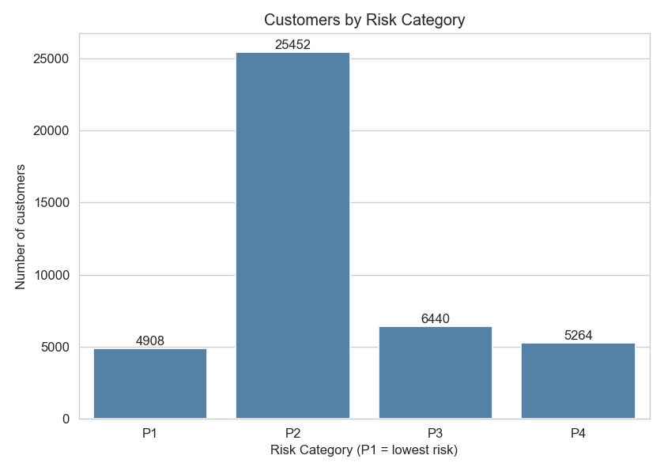
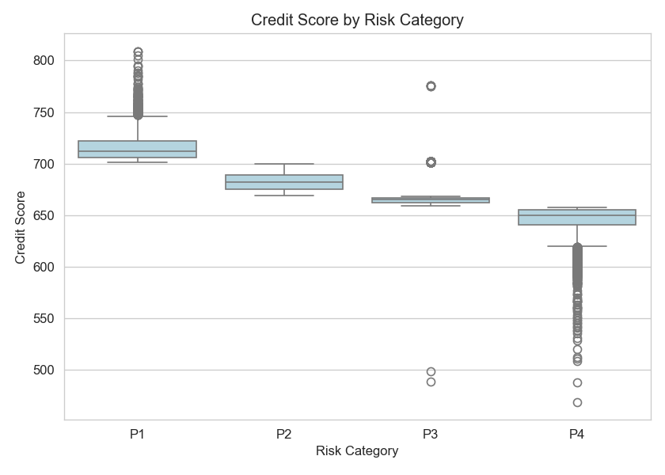
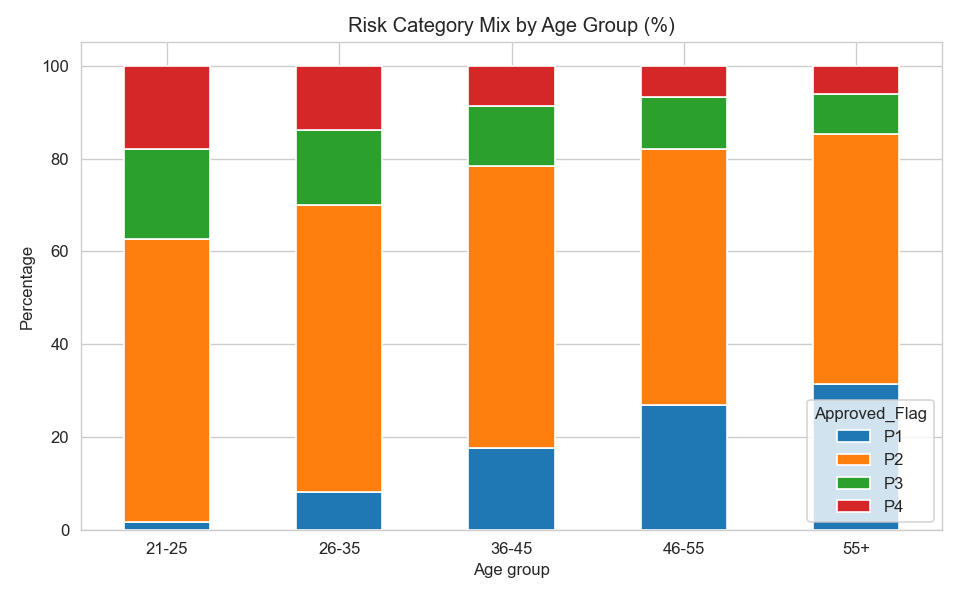
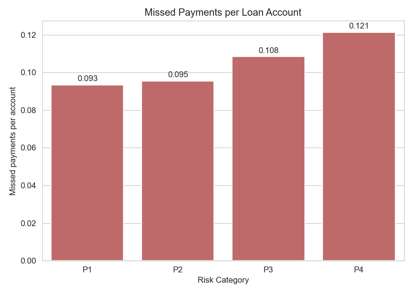
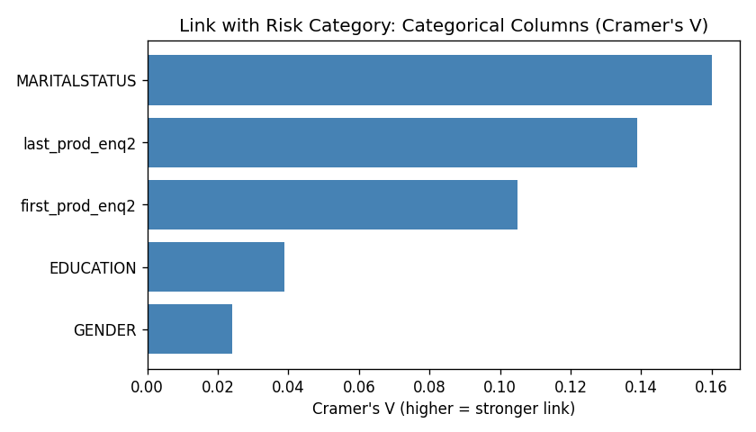
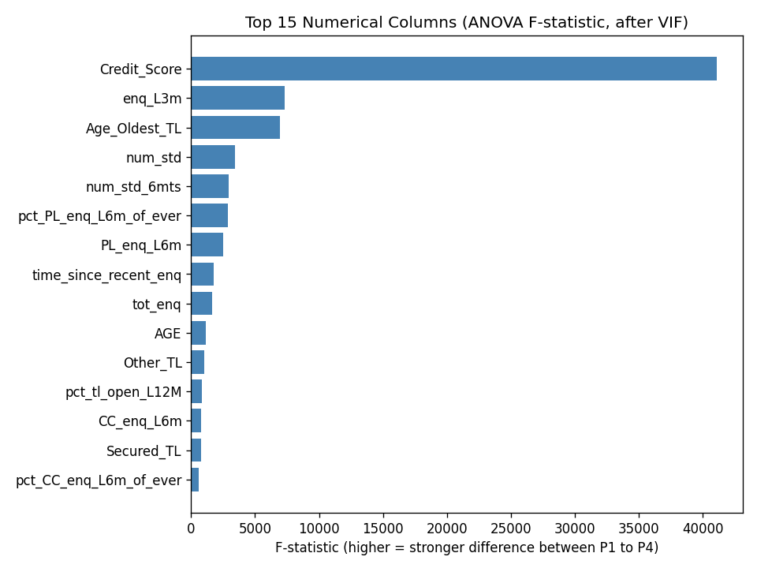

# Credit Risk Segmentation and Loan Approval Analysis

An end-to-end data analysis project on the credit data of 42,000+ bank customers.
The goal is to find out which customer characteristics are linked to lower or higher credit risk.

**Tools:** Python (pandas, matplotlib, seaborn) | SQL (SQLite) | Power BI | VS Code


---

## Business Problem

A bank wants to understand its customers better before approving loans.
Each customer is placed in a risk category (P1 to P4). This project answers questions like:

- How are customers spread across the risk categories?
- Do age, income or education change the risk?
- Which customer behaviours (credit enquiries, missed payments) are warning signs?
- Which first product enquiry leads to the best customers?

## Dataset

| File | Source | Rows | Columns |
|---|---|---|---|
| `case_study1.xlsx` | Internal bank data (loan accounts, missed payments) | 51,336 | 26 |
| `case_study2.xlsx` | External credit bureau data (enquiries, credit score, demographics) | 51,336 | 62 |

Both files are joined on `PROSPECTID`. The column `Approved_Flag` (P1 to P4) is the risk category.

**Assumption:** the dataset has no data dictionary, so I treated **P1 as the lowest risk and P4 as the highest risk**.
This matches the credit score pattern in the data (average score: P1 = 716, P2 = 682, P3 = 667, P4 = 645).

## Project Structure


```
credit-risk-analysis/
├── data/
│   ├── raw/                      original Excel files
│   └── processed/                clean CSV, cleaning log, SQLite database, Power BI file, test results
├── scripts/
│   ├── 01_data_cleaning.py       clean and merge the two datasets
│   ├── 02_eda_visualization.py   11 charts
│   ├── 03_load_to_sqlite.py      create the SQL database
│   ├── 04_export_for_powerbi.py  Power BI ready file
│   └── 05_statistical_testing.py Chi-Square, ANOVA and VIF
├── sql/
│   └── analysis_queries.sql      14 queries
├── powerbi/
│   ├── powerbi_guide.md          DAX measures and dashboard build steps
│   └── credit_risk_dashboard.pbix
├── images/                       EDA charts and dashboard screenshot
├── run_all.py                    runs all five scripts
├── run_sql.py                    runs one SQL query and prints the result
└── requirements.txt
```

## How to Run

```
pip install -r requirements.txt
python run_all.py
```

To run a SQL query (numbers 1 to 14):

```
python run_sql.py 1
python run_sql.py 7
```

The database file is `data/processed/loan_data.db`. You can also open it with a SQLite extension in VS Code.

---

## 1. Data Cleaning

- Missing values were stored as `-99999` instead of blanks.
- **Dataset 1:** only 2 columns had missing values (40 rows), so those rows were removed.
- **Dataset 2:** 8 columns had more than 10,000 missing values, so those columns were dropped.
  The few remaining rows with missing values were removed.
- Inner join on `PROSPECTID`: **42,064 customers** remain, with no duplicates and no nulls.
- New columns added for analysis: `Age_Group`, `Income_Band`, `Score_Band`, `Has_Missed_Payment`, `Risk_Category`.

## 2. Exploratory Data Analysis

11 charts were created with matplotlib and seaborn and saved in `images/`.

| | |
|---|---|
|  |  |
|  |  |


## 3. Statistical Testing

Which columns are really linked to the risk category? Three tests were used (`05_statistical_testing.py`), with a significance level of 0.05.

**Chi-Square test (categorical columns vs risk category)**
- H0: the column and the risk category are independent. H1: they are related.
- Cramer's V shows how strong the link is.

| Column | P-value | Cramer's V |
|---|---|---|
| MARITALSTATUS | below 0.001 | 0.160 |
| last_prod_enq2 | below 0.001 | 0.139 |
| first_prod_enq2 | below 0.001 | 0.105 |
| EDUCATION | below 0.001 | 0.039 |
| GENDER | below 0.001 | 0.024 |

All five are statistically significant, but the links are weak. Gender is almost irrelevant (V = 0.024).

**ANOVA (numerical columns vs risk category)**
- H0: the average of the column is the same in P1, P2, P3 and P4. H1: at least one category is different.
- 72 columns tested, 69 are significant. The 3 that are not: `num_lss_12mts`, `num_lss_6mts`, `pct_currentBal_all_TL`.
- Eta squared shows how much of the variation the risk category explains.

| Column | F-statistic | Eta squared |
|---|---|---|
| Credit_Score | 41,072 | 0.75 |
| enq_L3m (enquiries, last 3 months) | 7,319 | 0.34 |
| Age_Oldest_TL (age of oldest loan account) | 6,959 | 0.33 |

**VIF (multicollinearity)**
- Many columns repeat the same information (for example total accounts = closed + active accounts).
- Columns were removed one by one until every VIF was below 5. `Credit_Score` was kept on purpose (VIF 5.4) because it is the strongest column.
- Result: 69 significant columns reduced to **46**. The list is in `data/processed/stats_selected_features.csv`.

**Why effect size matters:** with 42,000+ rows, almost every p-value is close to zero. A small p-value only says that a link exists, not that it is strong. That is why Cramer's V and eta squared are reported next to the p-values.

| | |
|---|---|
|  |  |

## 4. SQL Analysis

`sql/analysis_queries.sql` has 14 queries that use:

- `GROUP BY` and aggregate functions (`COUNT`, `AVG`, `SUM`)
- `CASE WHEN` for percentages
- Subqueries
- A window function (`RANK`)

Example: share of high risk customers (P3 + P4) by age group.

```sql
SELECT
    age_group,
    COUNT(*) AS total_customers,
    ROUND(SUM(CASE WHEN approved_flag IN ('P3', 'P4') THEN 1 ELSE 0 END) * 100.0 / COUNT(*), 2) AS high_risk_pct
FROM customers
GROUP BY age_group
ORDER BY age_group;
```

## 5. Power BI Dashboard

A single-page dark theme dashboard with 4 KPI cards, 3 filters (Gender, Age Group, Education) and 5 charts.
Data file: `data/processed/powerbi_data.csv`.

| Measure | What it shows |
|---|---|
| Total Customers | Number of customers |
| High Risk % | Customers in P3 and P4 divided by all customers |
| Low Risk % | Customers in P1 divided by all customers |
| Missed Payments per Account | Total missed payments divided by total loan accounts |
| Avg Enquiries 12M | Average credit enquiries in the last 12 months |

All DAX formulas and the step by step build guide are in [`powerbi/powerbi_guide.md`](powerbi/powerbi_guide.md).

---

## Key Findings

| # | Finding | Evidence |
|---|---|---|
| 1 | Most customers are in the middle category | P2 is 60.5% of customers. P1 is 11.7%, P3 is 15.3%, P4 is 12.5% |
| 2 | Younger customers are riskier | High risk share (P3 + P4) falls from 37.3% (age 21-25) to 14.7% (age 55+) |
| 3 | Many credit enquiries are a warning sign | P4 customers made 8.0 enquiries in 12 months on average, P1 customers only 1.5 |
| 4 | Income alone does not separate risk | High risk share stays between 26.5% and 29.1% in every income band |
| 5 | Missed payments need a fair comparison | P1 customers hold about twice as many loan accounts (10.1 vs 4.5 for P2), so total missed payments look high. Per account, P1 is the best (0.093 vs 0.121 for P4) |
| 6 | Home loan holders are the best segment | 35.9% of customers with a home loan are P1, against 10.2% without one |
| 7 | First product enquired matters | 27.2% of customers who first enquired about a home loan are P1, against 5.9% for consumer loans |
| 8 | Education | Post-graduates have 16.0% P1 customers, against about 10% for SSC and 12th pass |

## Recommendations

- Treat a high number of recent credit enquiries as an early warning sign when reviewing loan applications.
- Review applications from the 21-25 age group with extra care, as this group has the highest share of high risk customers.
- Do not use income alone to judge risk. Combine it with enquiries and repayment behaviour.
- Home loan and auto loan enquirers are strong segments for targeted offers.

## Skills Demonstrated

- Data cleaning and merging with pandas
- Handling placeholder missing values
- Feature creation (age, income and score bands)
- Exploratory data analysis and visualisation
- SQL (aggregation, CASE WHEN, subqueries, window functions)
- Power BI: data modelling, DAX measures, dashboard design

## Limitations

- The meaning of P1 to P4 is assumed from the credit score pattern, as there is no data dictionary.
- The findings show association, not cause.
- The dataset has no date column, so trends over time could not be analysed.
- A few income values are very high (maximum is 25 lakh) and were kept as they are.
- Some groups are small. For example, only 219 customers have a "Professional" education level, so that percentage should be read with care.

## Next Steps

- Build a classification model to predict the risk category.
- Add time based analysis if date data becomes available.
- Test how much each factor (age, enquiries, missed payments) contributes to the risk category.
