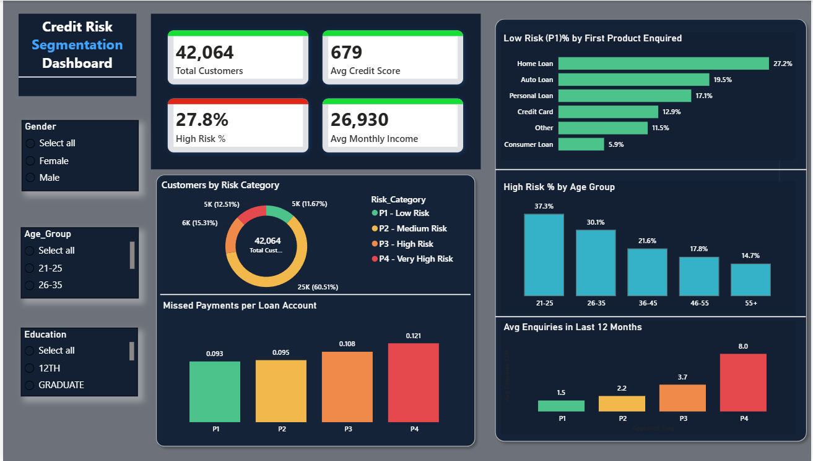

# Power BI Dashboard Guide

Single page, dark theme dashboard for the Credit Risk Segmentation project.

- **Data file:** `data/processed/powerbi_data.csv` (42,064 rows, 25 columns)
- **Final file:** `powerbi/credit_risk_dashboard.pbix`
- **Page size:** 1280 x 720 (16:9)

**What is on the page:** 3 filters, 4 KPI cards, 5 charts and a Key Findings box.



---

## 1. Load and prepare the data

### 1.1 Load the file
1. Open Power BI Desktop.
2. **Home > Get data > Text/CSV**, select `powerbi_data.csv`, click **Transform Data**.

### 1.2 Check data types (Power Query)
Click the small icon at the left of a column name to change its type.

| Columns | Type |
|---|---|
| Customer_ID | Text |
| Age, Monthly_Income, Credit_Score | Whole Number |
| Total_TL, Tot_Active_TL, Tot_Closed_TL, Tot_Missed_Pmnt | Whole Number |
| Total_Enquiries, Enquiries_Last_6M, Enquiries_Last_12M | Whole Number |
| All other text columns (Gender, Education, Risk_Category, ...) | Text |

Click **Home > Close & Apply**.

If a number column is stored as Text, measures that use it will show blank. This is the most common reason for an empty chart.

### 1.3 Fix the order of the band columns
Power BI sorts text alphabetically. The file already has sort columns, so use them.

1. Open **Data view** (table icon on the left).
2. Click the column in the Data pane, then **Column tools > Sort by column**:

| Column | Sort by |
|---|---|
| Age_Group | Age_Group_Sort |
| Income_Band | Income_Band_Sort |
| Score_Band | Score_Band_Sort |

Go back to **Report view**.

---

## 2. DAX measures

A measure is a formula that Power BI recalculates for every chart and filter.

**How to create one:** right-click the table `powerbi_data` in the Data pane > **New measure** > paste one formula > Enter. Repeat for each measure.

### 2.1 Core measures

```
Total Customers = COUNTROWS(powerbi_data)

Avg Credit Score = AVERAGE(powerbi_data[Credit_Score])

Avg Monthly Income = AVERAGE(powerbi_data[Monthly_Income])

High Risk Customers =
CALCULATE([Total Customers], powerbi_data[Approved_Flag] IN {"P3", "P4"})

High Risk % = DIVIDE([High Risk Customers], [Total Customers], 0)

Low Risk Customers =
CALCULATE([Total Customers], powerbi_data[Approved_Flag] = "P1")

Low Risk % = DIVIDE([Low Risk Customers], [Total Customers], 0)

Avg Enquiries 12M = AVERAGE(powerbi_data[Enquiries_Last_12M])

Total Missed = SUM(powerbi_data[Tot_Missed_Pmnt])

Total Accounts = SUM(powerbi_data[Total_TL])

Missed Payments per Account = DIVIDE([Total Missed], [Total Accounts], 0)
```

### 2.2 Measures for the donut chart block

```
Customers % =
DIVIDE([Total Customers], CALCULATE([Total Customers], ALLSELECTED(powerbi_data)), 0)

Legend Text =
FORMAT([Total Customers], "#,##0") & " (" & FORMAT([Customers %], "0.0%") & ")"

Risk Color =
SWITCH(SELECTEDVALUE(powerbi_data[Approved_Flag]),
    "P1", "#4CC38A",
    "P2", "#F2B84B",
    "P3", "#F08A4B",
    "P4", "#E5484D",
    "#9FB0C8")
```

### 2.3 Measures for the small text under the KPI cards (optional)

```
Score Range Text =
"Range " & MIN(powerbi_data[Credit_Score]) & " to " & MAX(powerbi_data[Credit_Score])

High Risk Count Text =
FORMAT([High Risk Customers], "#,##0") & " customers"

Median Income Text =
"Median " & FORMAT(MEDIAN(powerbi_data[Monthly_Income]), "#,##0")
```

### 2.4 Measure for the grey track behind the product bars (optional)

```
Track = 0.3
```

### 2.5 Format the measures
Click the measure, then use **Measure tools** in the top menu.

| Measure | Format | Decimals |
|---|---|---|
| Total Customers, Total Missed, Total Accounts | Whole number, comma on | 0 |
| Avg Credit Score | Whole number | 0 |
| Avg Monthly Income | Whole number, comma on | 0 |
| High Risk %, Low Risk %, Customers %, Track | Percentage | 1 |
| Avg Enquiries 12M | Decimal number | 1 |
| Missed Payments per Account | Decimal number | 3 |

### 2.6 What the measures mean

| Measure | Meaning |
|---|---|
| High Risk % | Customers in P3 and P4 divided by all customers |
| Low Risk % | Customers in P1 divided by all customers |
| Missed Payments per Account | Total missed payments divided by total loan accounts. P1 customers hold about twice as many accounts, so this is a fairer comparison than the plain total |
| Avg Enquiries 12M | Average credit enquiries in the last 12 months |

---

## 3. Design settings

### 3.1 Page size
Click an empty area of the page. **Format pane > Page > Canvas settings > Type: 16:9**.

### 3.2 Colours

| Use | Colour |
|---|---|
| Page background | `#0B1220` |
| Card and visual background | `#131F33` |
| Border and grid lines | `#22344F` |
| Main text | `#E6EDF7` |
| Secondary text | `#9FB0C8` |
| Accent (single colour charts) | `#35B2C7` |
| P1 Low Risk | `#4CC38A` |
| P2 Medium Risk | `#F2B84B` |
| P3 High Risk | `#F08A4B` |
| P4 Very High Risk | `#E5484D` |

Use the same four risk colours in every chart.

**To set a colour:** click the colour box > **Custom colour** > type the code in the Hex box (without `#`).

**Page background:** click an empty area > **Format page > Canvas background** > colour `0B1220`, Transparency 0%. Do the same for **Wallpaper** if you want the area outside the page to match.

### 3.3 Fonts
Segoe UI everywhere.

| Item | Size |
|---|---|
| Dashboard title | 24, bold |
| Chart title | 13, bold |
| Chart subtitle | 11 |
| KPI value | 28, bold |
| Axis and data labels | 11 |

### 3.4 Standard look for every visual
Select the visual, then **Format visual**:

- **General > Effects > Background:** On, `131F33`, Transparency 0%
- **General > Effects > Visual border:** On, `22344F`, rounded corners 8
- **General > Title:** On, text `E6EDF7`, size 13, bold
- Gridlines: Off
- Axis text: `9FB0C8`

Tip: format one visual first, then use **Home > Format painter** to copy the look to the others. Or copy and paste a finished chart (Ctrl + C, Ctrl + V) and only change the fields.

---

## 4. Layout (position of every visual)

Select a visual > **Format visual > General > Properties** and enter the position and size.

```
 20                                                                      1260
 +-----------------------------------------------------------------------+ y=10
 | Title                          [Gender] [Age Group] [Education]       |
 +--------------+--------------+--------------+--------------------------+ y=72
 | Total        | Avg Credit   | High Risk %  | Avg Monthly Income       |
 | Customers    | Score        |              |                          |
 +--------------+--------------+--------------+--------------------------+ y=168
 | Donut        | High Risk %  | Avg Enquiries 12M                       |
 | Risk         | by Age Group | by Risk Category                        |
 +--------------+--------------+-----------------------------------------+ y=444
 | Missed per   | P1 % by      | Key Findings                            |
 | Account      | First Product|                                         |
 +--------------+--------------+-----------------------------------------+ y=704
                     Source line (centre, bottom)
```

| # | Visual | X | Y | Width | Height |
|---|---|---|---|---|---|
| 1 | Title text box | 20 | 10 | 560 | 50 |
| 2 | Slicer: Gender | 600 | 10 | 150 | 56 |
| 3 | Slicer: Age_Group | 760 | 10 | 190 | 56 |
| 4 | Slicer: Education | 960 | 10 | 300 | 56 |
| 5 | Card: Total Customers | 20 | 72 | 298 | 80 |
| 6 | Card: Avg Credit Score | 334 | 72 | 298 | 80 |
| 7 | Card: High Risk % | 648 | 72 | 298 | 80 |
| 8 | Card: Avg Monthly Income | 962 | 72 | 298 | 80 |
| 9 | Donut block (panel) | 20 | 168 | 400 | 260 |
| 10 | Column: High Risk % by age | 436 | 168 | 410 | 260 |
| 11 | Column: Avg enquiries | 862 | 168 | 398 | 260 |
| 12 | Column: Missed per account | 20 | 444 | 400 | 260 |
| 13 | Bar: P1 % by first product | 436 | 444 | 410 | 260 |
| 14 | Text box: Key Findings | 862 | 444 | 398 | 260 |
| 15 | Text box: Source line | 336 | 706 | 600 | 20 |

---

## 5. Build every visual

Method for every chart: click an empty area, choose the visual in the **Visualizations** pane, drag fields from the **Data** pane into the boxes, then apply the standard look (3.4) and the position (Part 4).

### 5.1 Title
**Insert > Text box.**
- Line 1: `Credit Risk Segmentation Dashboard` (size 24, bold, `E6EDF7`)
- Line 2: `Loan approval insights | Bank data + credit bureau data | 42,064 customers` (size 11, `9FB0C8`)

### 5.2 Slicers (three dropdown filters)
Use the visual named just **Slicer**. Do not use Button slicer or other slicer types, because only the normal Slicer has the Dropdown style.

1. Visualizations pane > hover over the icons and pick the one called **Slicer**.
2. Field: `Gender`.
3. **Format visual > Slicer settings > Options > Style: Dropdown**.
4. **Slicer settings > Selection:**
   - Single select: **Off**
   - Show "Select all" option: **On**
5. **Slicer header:** On, text `9FB0C8`, size 11. Change the header text to `Gender`.
6. **Values:** font `E6EDF7`, size 12, background `131F33`.
7. **Visual border:** On, `22344F`, rounded corners 6. General background: Off.
8. Copy and paste the slicer twice, then change the field and header text:

| Slicer | Field | Header text |
|---|---|---|
| 1 | Gender | Gender |
| 2 | Age_Group | Age Group |
| 3 | Education | Education |

Before you continue, click **Select all** in each slicer. A leftover selection filters every chart and changes your numbers.

### 5.3 KPI cards
Visualizations pane > **Card**.

| Card | Field |
|---|---|
| 1 | Total Customers |
| 2 | Avg Credit Score |
| 3 | High Risk % |
| 4 | Avg Monthly Income |

For each card:
- **Callout value:** size 28, bold, `E6EDF7` (for High Risk % use `E5484D`)
- **Category label:** On, size 12, `9FB0C8`
- Background and border as in 3.4
- Optional top accent line: add a thin rectangle (height 4) above the card in `35B2C7` (red `E5484D` for High Risk %)

Optional small line under each value: add a small Card with `Score Range Text`, `High Risk Count Text` or `Median Income Text`. Turn off its title and background, set size 11, colour `9FB0C8`, and place it inside the KPI card.

### 5.4 Donut block: Customers by Risk Category
This block has four parts placed on top of each other.

**Panel**
- **Insert > Shapes > Rectangle:** X 20, Y 168, Width 400, Height 260. Fill `131F33`, border `22344F`, rounded corners 8.
- Two text boxes: title `Customers by Risk Category` (size 13, bold) and subtitle `P1 = lowest risk, P4 = highest risk` (size 11, `9FB0C8`).

**Donut**
- Visual: **Donut chart**. Legend: `Risk_Category`. Values: `Total Customers`.
- Position: X 28, Y 230, Width 170, Height 190.
- Format: Legend Off, Detail labels Off, Title Off, Background Off, Border Off. Slices colours: P1 `4CC38A`, P2 `F2B84B`, P3 `F08A4B`, P4 `E5484D`. Inner radius about 65%.

**Number in the middle**
- Visual: **Card** with `Total Customers`. Position: X 73, Y 300, Width 80, Height 50.
- Callout size 16, bold, `E6EDF7`. Rename the label to `customers` (size 10, `9FB0C8`). Background, border and title Off.
- **Format > Arrange > Bring to front**, so it stays above the donut.

**Legend on the right**
- Visual: **Table** with columns `Risk_Category` and `Legend Text`. Position: X 205, Y 250, Width 205, Height 150.
- Column headers Off, gridlines Off, style None, background and border Off, text `E6EDF7`, size 12.
- Colour the text by risk: **Cell elements > Series: Risk_Category > Font colour > fx > Field value > Risk Color**.

Select the whole block (Ctrl + click) and **Group** it.

Simple alternative: use only the donut with **Legend On (Right)** and **Detail labels: Category, value, percent of total**.

### 5.5 Column chart: High Risk % by Age Group
- Visual: **Clustered column chart**.
- X-axis: `Age_Group`. Y-axis: `High Risk %`.
- Sort: chart **... > Sort axis > Age_Group > Sort ascending**.
- Columns colour `35B2C7`, inner padding 15%.
- Data labels On, size 11, `E6EDF7`, decimal places 1, Display units None.
- Y-axis: set Range Minimum to 0, then turn the axis Off. Gridlines Off. X-axis title Off.
- Title `High Risk % by Age Group`, subtitle `Share of customers in P3 + P4`.

### 5.6 Column chart: Avg Enquiries in Last 12 Months
- Visual: **Clustered column chart**.
- X-axis: `Approved_Flag`. Y-axis: `Avg Enquiries 12M`.
- Sort: **Sort axis > Approved_Flag > Sort ascending**, so the order is P1 to P4.
- **Columns > Colours > Show all:** P1 `4CC38A`, P2 `F2B84B`, P3 `F08A4B`, P4 `E5484D`.
- Data labels On, decimal places 1. Y-axis Minimum 0, then Off. Gridlines Off.
- Title `Avg Enquiries in Last 12 Months`, subtitle `Higher risk customers enquire far more`.

### 5.7 Column chart: Missed Payments per Loan Account
Copy the chart from 5.6 (Ctrl + C, Ctrl + V), then:
- Replace the Y-axis field with `Missed Payments per Account`.
- Data labels: decimal places **3**.
- Title `Missed Payments per Loan Account`, subtitle `Fair comparison: P1 holds 2x more accounts`.

### 5.8 Bar chart: Low Risk (P1) % by First Product Enquired
- Visual: **Clustered bar chart**.
- Y-axis: `First_Product`. X-axis: `Low Risk %`.
- Sort: **Sort axis > Low Risk % > Sort descending**.
- Bars colour `4CC38A`, inner padding 30%. Data labels On, decimal places 1.
- X-axis Off, gridlines Off, Y-axis text `9FB0C8`, axis title Off.
- Title `Low Risk (P1) % by First Product Enquired`, subtitle `Which first enquiry leads to the best customers`.

**Optional grey track behind the bars:**
1. Add `Track` to the X-axis, above `Low Risk %`.
2. **Bars > Layout > Series overlap:** 100%.
3. Colours by series: `Track` = `22344F`, `Low Risk %` = `4CC38A`.
4. Data labels: Off for `Track`, On for `Low Risk %`.
5. X-axis Range: Minimum 0, Maximum 0.3. Legend Off.
6. If a filter pushes a value above 30%, raise both the Maximum and the `Track` value (for example 0.5).

### 5.9 Key Findings box
**Insert > Text box.** Heading `Key Findings`, small line `Overall data, all 42,064 customers`, then:

```
1. Age matters. High risk share falls from 37.3% (age 21-25) to 14.7% (55+).
2. Enquiries are a warning sign. P4 customers made 8.0 enquiries in 12 months, P1 only 1.5.
3. Income alone is weak. High risk share stays at 26-29% in every income band.
4. Best segment. 27.2% of home loan enquirers are P1, against 5.9% for consumer loans.
```

Heading size 13 bold, text size 11, `E6EDF7`. Background `131F33`, border `22344F`.

This text is fixed. It does not change when a slicer is used, which is why the box says "Overall data".

### 5.10 Source line
**Insert > Text box** at the bottom centre: `Source: powerbi_data.csv | Python (cleaning), SQL (analysis), Power BI (dashboard)` (size 11, `9FB0C8`).

---

## 6. Check your numbers

With **no filter selected** (click Select all in every slicer), the dashboard should show:

| Item | Expected |
|---|---|
| Total Customers | 42,064 |
| Avg Credit Score | 679 |
| High Risk % | 27.8% |
| Avg Monthly Income | about 26,930 |
| Total Missed / Total Accounts | about 22K / 221K |
| Donut | P1 4,908 (11.7%), P2 25,452 (60.5%), P3 6,440 (15.3%), P4 5,264 (12.5%) |
| High Risk % by age | 37.3%, 30.1%, 21.6%, 17.8%, 14.7% |
| Avg enquiries 12M | P1 1.5, P2 2.2, P3 3.7, P4 8.0 |
| Missed per account | P1 0.093, P2 0.095, P3 0.108, P4 0.121 |
| Low Risk % by first product | Home Loan 27.2%, Auto Loan 19.5%, Personal Loan 17.1%, Credit Card 12.9%, Other 11.5%, Consumer Loan 5.9% |

You can cross-check with the SQL results: `python run_sql.py 1`, `python run_sql.py 7`, `python run_sql.py 8`.

Filter test: select only Female in the Gender slicer. The numbers should drop below 42,064 and every chart should update. Then click Select all again.

---

## 7. Common problems

| Problem | Fix |
|---|---|
| Chart is empty | A number column is stored as Text. Change it to Whole number in Data view (Column tools > Data type) |
| Chart shows bars for Total Customers but not for a new measure | Split the measure into two small measures (like Total Missed and Total Accounts) and test each one in a Card |
| Labels show 0.1 instead of 0.093 | Set the measure format to 3 decimals, and in Data labels set decimal places to 3 and Display units to None |
| Numbers differ from the table in Part 6 | A slicer or filter is still selected. Click Select all and check the Filters pane |
| Bars are in the wrong order (P4 first, 55+ first) | Chart **... > Sort axis > the axis field > Sort ascending**. For bands, also do step 1.3 |
| Slicer shows radio buttons or has no Dropdown option | You used a different slicer type. Use the plain **Slicer** visual, and set Style to Dropdown |
| Slicer header shows `Age_Group` | Change the Slicer header title text to `Age Group` |
| Percentage shows 0.278 | Format the measure as Percentage |
| Every bar has the same colour | Turn on **Columns > Colours > Show all** |
| Number card in the donut is hidden | Select the card, then **Format > Arrange > Bring to front** |
| A card shows the sum of Customer_ID | Change Customer_ID to Text |
| Old visuals from another project appear | Start a new file: **File > New**, load only `powerbi_data.csv`, and rebuild |

---


